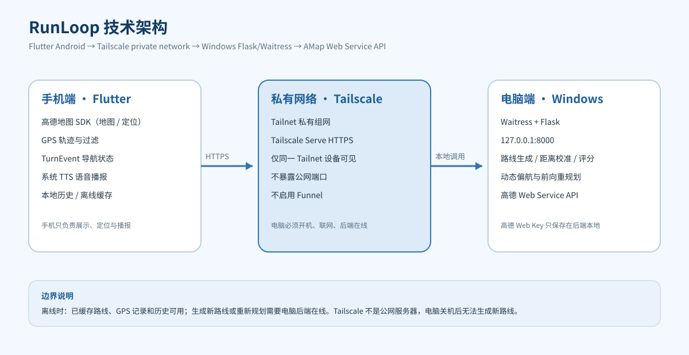

# RunLoop

English | [简体中文](README.md)


RunLoop is an Android running-route planner built with **Flutter, AMap (Gaode Maps), and a Python backend**. The user enters a target distance, and the app generates a real-road closed loop that starts and ends at the same place. It also provides candidate previews, map navigation, GPS tracking, voice prompts, and run history.

RunLoop is not another running timer. It focuses on a practical question: "I want to run 5 km or 15 km today; where can I find a nearby loop that does not repeat the same road and brings me back to the start?"

---

## Contents

- [1. Overview](#1-overview)
- [2. Motivation](#2-motivation)
- [3. Features](#3-features)
- [4. Current Status and Boundaries](#4-current-status-and-boundaries)
- [5. Architecture](#5-architecture)
- [6. Technology Stack](#6-technology-stack)
- [7. Repository Layout](#7-repository-layout)
- [8. Windows Prerequisites](#8-windows-prerequisites)
- [9. Getting the Code](#9-getting-the-code)
- [10. Backend Setup](#10-backend-setup)
- [11. AMap Keys](#11-amap-keys)
- [12. Tailscale Setup](#12-tailscale-setup)
- [13. Build and Install the Android App](#13-build-and-install-the-android-app)
- [14. Tests](#14-tests)
- [15. Usage](#15-usage)
- [16. Offline Behavior](#16-offline-behavior)
- [17. FAQ](#17-faq)
- [18. Security and Privacy](#18-security-and-privacy)
- [19. Development History](#19-development-history)
- [20. Contributing, License, and Disclaimer](#20-contributing-license-and-disclaimer)

---

## 1. Overview

RunLoop is designed for campus runs, long slow distance (LSD) training, and outdoor running. After the user selects a target distance, the backend:

1. generates a set of control points around the current location;
2. requests real walking routes from AMap for each leg;
3. assembles the legs into a closed loop;
4. calibrates the distance and computes quality metrics;
5. returns multiple candidate routes for preview and selection.

During a run, the Android app records GPS tracks, distance, duration, and pace. It also provides voice prompts based on a unified turn-event model. If the runner deviates, the app can request a new route online. If no reasonable forward rejoin is possible, it reports the situation clearly instead of silently forcing a U-turn.

> The current version has passed the user's main real-device tests and runs without obvious blockers. Two areas are still being improved: generation speed for long routes and forward rerouting on complex junctions or parallel roads.

---

## 2. Motivation

The project comes from a marathon runner's real experience: the loop around the campus is about 5 km, so long runs require repeating the same loop; running dozens of laps on a track is monotonous.

RunLoop aims to address:

- repetitive and monotonous fixed routes;
- difficulty finding a suitable closed loop for a given distance;
- the planning burden of long-distance routes;
- the lack of continuous route guidance during a run;
- fragmented running records and history.

---

## 3. Features

- Preset and custom target distances: 1 / 2.5 / 5 / 15 / 50 km, or a custom value;
- Closed loops on real walking roads, not circles or straight lines drawn on a map;
- Multiple candidate routes with map preview;
- Distance error, closure error, turn count, repetition, and other metrics;
- Real-time GPS tracking, route, distance, duration, and pace;
- Map navigation and next-turn hints;
- Chinese voice prompts for countdown, turns, per-kilometer pace, and goal completion;
- Deviation detection and dynamic rerouting;
- Pause, resume, and a confirmation dialog before ending a run;
- Run history and summaries;
- Local caching of generated routes for offline viewing.


> This is a real app screenshot cropped to remove map-location details.

---

## 4. Current Status and Boundaries

Implemented and mainly validated on the user's phone:

- target-distance generation, candidate selection, GPS recording, navigation, voice prompts, pause/resume, end confirmation, and history;
- real AMap API regressions for 1 / 2.5 / 5 / 15 / 50 km;
- automated tests for both the app and the backend.

Known limitations:

1. **Long-route generation time**: 50 km takes roughly 143 seconds and 402 AMap requests, limited by QPS. There is still room for improvement.
2. **Forward rerouting**: complex junctions and parallel roads may still require better direction constraints. When no reasonable rejoin exists, the app states this clearly rather than silently forcing a U-turn.
3. **Road-data limits**: AMap does not provide complete lighting, real-time traffic, road-width, or temporary-closure data. RunLoop therefore does not claim a comprehensive safety score.
4. **Deployment boundary**: the personal setup depends on a Windows backend and Tailscale. The PC must be powered on, online, and running the backend. Offline use is limited to cached routes and GPS recording; new routes cannot be generated offline.
5. **Platform scope**: Android is the current target; iOS is not implemented.

---

## 5. Architecture



Data flow:

```text
Flutter Android App
  -> Tailscale Tailnet (private mesh)
  -> Tailscale Serve (HTTPS inside the tailnet)
  -> Windows Flask + Waitress (127.0.0.1:8000)
  -> AMap Web Service API (real walking routes)
```

Important points:

- Tailscale is a **private mesh network**, not a public cloud server and not a way to expose the PC to the public Internet;
- the phone and the PC must sign in to the same Tailnet;
- the phone can use mobile data outdoors and still reach the PC backend; the two devices do not need to be on the same campus Wi-Fi;
- the PC must stay powered on and online, and the backend must be running;
- do not enable Tailscale Funnel for this personal backend;
- offline mode can use cached routes and GPS recording; new route generation and rerouting require the backend.

---

## 6. Technology Stack

| Layer | Technology | Role |
|---|---|---|
| Mobile | Flutter / Dart | Android UI, interaction, state management |
| Maps and location | AMap Android SDK | Map display and GPS location |
| Voice | Android system TTS (flutter_tts) | Chinese speech output |
| Backend | Python / Flask / Waitress | Route generation, scoring, rerouting API |
| Route data | AMap Web Service API | Real walking/driving routes |
| Network | Tailscale Tailnet + Serve | Private HTTPS access to the PC backend |
| Storage | sqflite / SharedPreferences | History, settings, offline cache |
| Tests | pytest / flutter_test | Backend and client tests |

---

## 7. Repository Layout

```text
RunLoop-app/
├── lib/                         Flutter source
│   ├── main.dart                App entry point
│   ├── app/config.dart          Backend URLs, map key, thresholds
│   ├── models/                  Route, step, track, and run models
│   ├── screens/                 Home, candidates, navigation, history, settings
│   ├── services/
│   │   ├── location/            AMap location wrapper
│   │   ├── nav/                 Navigation, TTS, deviation, camera, foreground service
│   │   ├── route_api/           Route generation and reroute HTTP clients
│   │   └── run_recorder/        GPS recording, filtering, splits
│   ├── utils/                   Geometry, route projection, turn annotations, heading
│   └── widgets/                 Countdown, arrow, km splits, end confirmation
├── backend/                     Python backend
│   ├── server.py                Flask routes, serialization, rate limiting
│   ├── serve.py                 Waitress production entry point
│   ├── guard.py                 Rate limiting, circuit breaker, concurrency gate
│   ├── reroute.py               Dynamic deviation and forward rerouting
│   └── route_generator/         Route-generation algorithm
├── android/                     Android native project
├── test/                        Flutter tests
├── tests/                       Python tests
├── config/                      Configuration templates (local secrets excluded)
├── deploy/                      Windows backend and Tailscale scripts
├── docs/                        Architecture, phase reports, presentation material
├── packages/                    Locally patched AMap Flutter plugins
├── assets/                      App icons and resources
├── tools/                       Development and diagnostic scripts
├── pubspec.yaml                 Flutter dependencies
└── .gitignore                   Secrets, build outputs, local files
```

See [docs/PROJECT_STRUCTURE.md](docs/PROJECT_STRUCTURE.md) for a file-by-file guide.

---

## 8. Windows Prerequisites

The following versions were used for the current project. Compatible alternatives may work.

| Tool | Suggested version | Official download |
|---|---|---|
| Git | Latest stable | https://git-scm.com/download/win |
| Flutter | 3.47.x (tested with 3.47.8) | https://docs.flutter.dev/get-started/install/windows |
| Python | 3.10+ (tested with 3.13) | https://www.python.org/downloads/windows/ |
| JDK | 17 or 21 LTS (JDK 25 also used during development) | https://adoptium.net/ |
| Android SDK | Platform 36 / Build Tools 36.0.0 | https://developer.android.com/studio |
| IDE | Android Studio or IntelliJ IDEA for Flutter; PyCharm for Python | https://www.jetbrains.com/ |
| Tailscale | Latest stable | https://tailscale.com/download/windows |

Environment variables:

- `ANDROID_HOME` should point to the Android SDK;
- add `flutter\bin` and `platform-tools` to `PATH`;
- verify with `java -version`, `flutter doctor`, and `python --version`.

---

## 9. Getting the Code

```bash
git clone https://github.com/Jiiiang0731/RunLoop.git
cd RunLoop
```

If you download a ZIP archive, enter the directory that contains `pubspec.yaml`; do not treat `build/` as the project root.

---

## 10. Backend Setup

### 10.1 Create a Python virtual environment

```powershell
cd D:\path\to\RunLoop
python -m venv .venv
.\.venv\Scripts\Activate.ps1
python -m pip install --upgrade pip
pip install -r requirements.txt
```

If PowerShell blocks the activation script:

```powershell
Set-ExecutionPolicy -Scope Process -ExecutionPolicy Bypass
```

### 10.2 Configure the AMap Web Service key

```powershell
copy config\amap_key.example config\amap_key.local
notepad config\amap_key.local
```

Put the **Web Service key** on the first line. Alternatively:

```powershell
$env:RUNLOOP_AMAP_KEY = "YOUR_WEB_SERVICE_KEY"
```

`config/amap_key.local` is ignored by Git. Never commit it.

### 10.3 Start the backend

```powershell
python backend\serve.py
```

Or use the repository script:

```powershell
powershell -ExecutionPolicy Bypass -File deploy\start_backend.ps1
```

The backend listens on `127.0.0.1:8000` by default. Check health:

```powershell
curl http://127.0.0.1:8000/api/health
```

A healthy response includes `status: ok`, `version`, `features`, and cache statistics.

---

## 11. AMap Keys

RunLoop uses two different AMap keys. Both must be created in the AMap open platform.

### 11.1 Web Service key (backend)

- Used by the backend for walking/driving route planning;
- stored only on the PC in `config/amap_key.local` or `RUNLOOP_AMAP_KEY`;
- never put it in the APK, Git, README, logs, or screenshots;
- console: https://console.amap.com/dev/key/app

### 11.2 Android platform SDK key (mobile map/location)

Create an **Android platform** key and bind it to:

- package name: `com.runloop.app`
- the SHA-1 of your signing certificate (debug or release)

Local setup:

```powershell
copy android\amap_key.properties.example android\amap_key.properties
notepad android\amap_key.properties
```

Example content:

```properties
amap.apiKey=YOUR_ANDROID_SDK_KEY
```

The same key must also be passed to Flutter at build time because the location service reads it from Dart:

```bash
--dart-define=AMAP_ANDROID_KEY=YOUR_ANDROID_SDK_KEY
```

Get SHA-1:

```powershell
# Debug certificate
keytool -list -v -keystore "$env:USERPROFILE\.android\debug.keystore" -alias androiddebugkey -storepass android

# Your release certificate
keytool -list -v -keystore path\to\your-release.jks -alias your-alias
```

> No release keystore is included in this repository. Create your own, then add its SHA-1 to the AMap console. After changing the certificate, update the Android key.

---

## 12. Tailscale Setup

Official downloads:

- All platforms: https://tailscale.com/download
- Windows: https://tailscale.com/download/windows
- Android: https://tailscale.com/download/android

Steps:

1. Install Tailscale on the Windows PC and sign in.
2. Install Tailscale on the Android phone and sign in to the **same account**.
3. Confirm that both devices are online in the same Tailnet.
4. Keep the backend running on `127.0.0.1:8000`.
5. Enable Tailscale Serve on the PC:

```powershell
tailscale serve --bg 8000
```

Or use:

```powershell
powershell -ExecutionPolicy Bypass -File deploy\setup_tailscale_serve.ps1
```

6. Read your Tailnet HTTPS address (example):

```text
https://your-device.your-tailnet.ts.net
```

7. Pass it to the Android build:

```bash
--dart-define=TAILNET_BASE_URL=https://your-device.your-tailnet.ts.net
```

Notes:

- do not enable `tailscale funnel`;
- never publish your real Tailnet hostname, account, or device names;
- the PC must stay on and online, and the backend must be running;
- the phone and PC do not need to be on the same Wi-Fi, but must be in the same Tailnet;
- cached routes and history work offline; new route generation and rerouting require the backend.

---

## 13. Build and Install the Android App

### 13.1 Fetch Flutter dependencies

```bash
flutter pub get
```

### 13.2 Debug APK

```bash
flutter build apk --debug \
  --dart-define=TAILNET_BASE_URL=https://your-device.your-tailnet.ts.net \
  --dart-define=AMAP_ANDROID_KEY=YOUR_ANDROID_SDK_KEY
```

Output: `build/app/outputs/flutter-apk/app-debug.apk`

### 13.3 Release APK

1. Prepare your own signing keystore.
2. Copy the signing template:

```powershell
copy android\key.properties.example android\key.properties
notepad android\key.properties
```

Example fields:

```properties
storePassword=YOUR_STORE_PASSWORD
keyPassword=YOUR_KEY_PASSWORD
keyAlias=YOUR_KEY_ALIAS
storeFile=path/to/your-release.jks
```

3. Build:

```bash
flutter build apk --release \
  --dart-define=TAILNET_BASE_URL=https://your-device.your-tailnet.ts.net \
  --dart-define=AMAP_ANDROID_KEY=YOUR_ANDROID_SDK_KEY
```

4. Verify the signature:

```bash
apksigner verify --verbose --print-certs build/app/outputs/flutter-apk/app-release.apk
```

5. Install:

```bash
adb install -r build/app/outputs/flutter-apk/app-release.apk
```

> Do not upload an APK that contains your personal Tailnet address to a public release. Other developers should rebuild with their own backend address.

---

## 14. Tests

### 14.1 Python backend

```bash
python -m pytest -q
```

Current baseline: 209 passing tests.

### 14.2 Flutter app

```bash
flutter test
flutter analyze lib test
```

Current baseline: 209 passing tests; static analysis reports 0 errors and 0 warnings (one historical info-level lint remains).

### 14.3 Real API regression

With the backend running, you can test 1 / 2.5 / 5 / 15 / 50 km against the real AMap API. Scripts and phase reports are under `docs/`. Real API calls consume AMap quota; control the request rate.

---

## 15. Usage

1. Open the app and grant location, notification, and required background permissions.
2. Choose a preset distance or enter a custom distance.
3. Generate a closed loop.
4. Review candidates, distance, error, closure, and quality metrics.
5. Select a route and start running.
6. View the map, GPS position, progress, and next turn.
7. Listen for the countdown, turn prompts, per-kilometer pace, and goal-completion message.
8. Pause or resume as needed; ending a run requires confirmation.
9. Review the run in history.

---

## 16. Offline Behavior

Available offline:

- previously generated and cached routes;
- run history;
- parts of settings and diagnostics;
- GPS track recording.

Requires the online backend (PC + Tailscale):

- generating a new closed loop;
- dynamic or forward rerouting after a deviation;
- other features that depend on the AMap Web Service.

If the PC is off, the network is down, or Tailscale is disconnected, the app reports the problem clearly and does not pretend that route generation succeeded.

---

## 17. FAQ

### Q1: "Server address is not configured"

The release build was created without `TAILNET_BASE_URL`. Rebuild with your own Tailnet address.

### Q2: The backend health check works, but the phone cannot connect

Check, in order: the PC is on, Tailscale is online, the phone is signed in to the same Tailnet, `tailscale serve --bg 8000` is active, and the phone can open `https://your-device.your-tailnet.ts.net/api/health`.

### Q3: AMap returns 10021 or 10003

10021 usually means the QPS/rate limit was exceeded; 10003 usually means the daily quota was exceeded. The backend applies a global rate limit and cache; reduce the request rate or check the AMap console quota.

### Q4: The map works but location keeps failing

Check that the Android key in `android/amap_key.properties` is bound to `com.runloop.app` and the correct SHA-1, and that location permission is granted. Use the app's location diagnostics page.

### Q5: TTS has no sound

Open the voice diagnostics page and check the engine, Chinese voice data, and a real speech test. Some vendors require downloading an offline Chinese voice; lock-screen speech is also affected by battery and autostart policies.

### Q6: A 1 km route is not exactly 1000 m

±500 m is the maximum tolerance, not the target. The internal target is about 5%; the campus test produced about 1030 m. Road networks differ by starting point.

### Q7: 50 km takes a long time

It requires many real road requests and is limited by AMap QPS. Caching, rate limiting, and early stopping help, but generation still takes time.

### Q8: Should Tailscale account/device names be published?

No. Mask account names, device names, Tailnet hostnames, and IPs in public material. The final RunLoop presentation masks these areas.

### Q9: Why do I need my own release keystore?

Android requires a stable release signature, and the AMap Android key is bound to the package name and SHA-1. No signing certificate is included in this repository.

### Q10: Can RunLoop plan new routes fully offline?

No. New routes require the AMap Web Service and the PC backend. Offline mode only guarantees cached routes and GPS recording.

---

## 18. Security and Privacy

- AMap Web Service keys, signing certificates, keystores, `.env` files, and personal Tailscale information are not committed;
- `config/amap_key.local`, `android/amap_key.properties`, and `android/key.properties` are excluded by `.gitignore`;
- the repository contains example files with placeholders only;
- RunLoop does not collect account passwords or personal location data;
- backend logs contain sanitized request summaries only;
- public screenshots and demo material should mask accounts, device names, Tailnet addresses, and personal GPS traces;
- the project is provided "as is" and does not guarantee road safety. See [DISCLAIMER.md](DISCLAIMER.md).

---

## 19. Development History

The project started on 28 October 2026 and has gone through feasibility validation, a 15 km closed-loop proof of concept, the first APK, map and location integration, route-algorithm redesign, Tailscale deployment, voice navigation, lock-screen and dynamic rerouting work, performance optimization, and forward rerouting.

Key reports:

- [Requirements and feasibility](docs/requirements.md)
- [Architecture](docs/architecture.md)
- [Phase D: route API](docs/phase_d_report.md)
- [Phase J: route selection](docs/phase_j_report.md)
- [Phase K: Tailscale](docs/phase_k_report.md)
- [Phase L: voice navigation](docs/phase_l_report.md)
- [Phase M: lock screen and rerouting](docs/phase_m_report.md)
- [Phase N: anchor loops](docs/phase_n_report.md)
- [Phase P0/P1: navigation fixes](docs/phase_p_report.md)
- [Phase Q: performance and forward rerouting](docs/phase_q_report.md)

See [docs/PROJECT_STRUCTURE.md](docs/PROJECT_STRUCTURE.md) for the complete documentation index.

---

## 20. Contributing, License, and Disclaimer

### Contributing

Please use GitHub Issues to report problems or suggest improvements. Before submitting code:

1. do not commit keys, certificates, personal addresses, or private tracks;
2. run `python -m pytest -q`, `flutter test`, and `flutter analyze lib test`;
3. explain the change, verification method, and anything not verified in the pull request.

### License

Released under the [MIT License](LICENSE). Third-party dependencies, map services, icons, and user-provided screenshots are not automatically covered by MIT; see [THIRD_PARTY_NOTICES.md](THIRD_PARTY_NOTICES.md).

### Disclaimer

Route planning depends on third-party map services and data. RunLoop does not guarantee complete information about lighting, real-time traffic, road width, or temporary closures. A generated route is not a guarantee of road safety. Run only on safe, permitted roads, and observe traffic and local rules. See [DISCLAIMER.md](DISCLAIMER.md) for details.

### Contact

GitHub: https://github.com/Jiiiang0731

---

## Presentation Material

The final presentation PPTX and PDF are kept locally under `dist/final/`. They contain real phone screenshots and a screen recording, so they are **not committed to the public repository** for privacy reasons. The term glossary and presentation Q&A guide is public at [docs/presentation/RunLoop_PPT术语解释与答辩指南.md](docs/presentation/RunLoop_PPT术语解释与答辩指南.md).

If you want to publish the presentation, mask accounts, device names, Tailnet addresses, and personal locations first, then upload it to GitHub Releases or a private document store.
