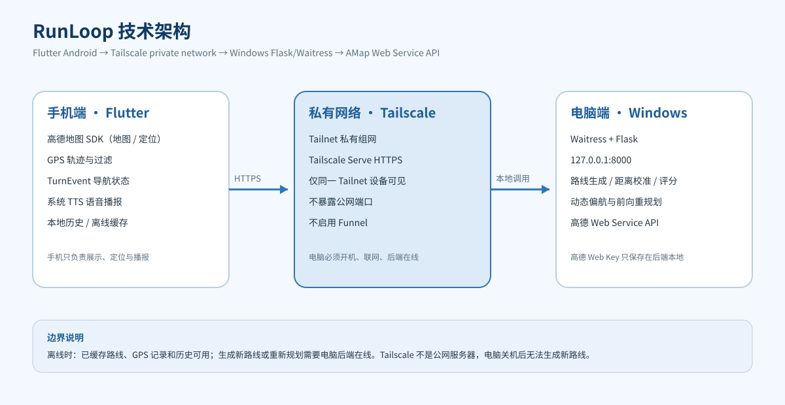

# RunLoop（环跑）

[English](README.en.md) | 简体中文


RunLoop 是一个基于 **Flutter + 高德地图 + Python 后端** 的 Android 跑步路线规划应用。用户输入目标距离，应用会调用真实步行道路数据，生成一条从起点出发并回到起点的闭合路线，并提供候选预览、地图导航、GPS 运动记录、语音提示与历史统计。

项目不是跑步计时器的替代品，重点解决“今天想跑 5 公里 / 15 公里，附近怎么跑一条不重复、能回到起点的路线”这个问题。

---

## 目录

- [1. 项目简介](#1-项目简介)
- [2. 设计初衷与解决的问题](#2-设计初衷与解决的问题)
- [3. 核心功能](#3-核心功能)
- [4. 项目现状与边界](#4-项目现状与边界)
- [5. 技术架构](#5-技术架构)
- [6. 技术栈](#6-技术栈)
- [7. 目录结构](#7-目录结构)
- [8. Windows 环境准备](#8-windows-环境准备)
- [9. 获取代码](#9-获取代码)
- [10. 后端部署](#10-后端部署)
- [11. 高德地图 Key 配置](#11-高德地图-key-配置)
- [12. Tailscale 私有网络配置](#12-tailscale-私有网络配置)
- [13. 构建与安装 Android App](#13-构建与安装-android-app)
- [14. 运行测试](#14-运行测试)
- [15. 使用流程](#15-使用流程)
- [16. 离线能力说明](#16-离线能力说明)
- [17. 常见问题](#17-常见问题)
- [18. 安全与隐私](#18-安全与隐私)
- [19. 项目阶段历史](#19-项目阶段历史)
- [20. 贡献、许可与免责声明](#20-贡献许可与免责声明)

---

## 1. 项目简介

RunLoop（中文名“环跑”）面向校园跑步、日常 LSD（长距离慢跑）和户外训练。用户选择或输入目标距离后，后端会：

1. 在当前位置附近生成控制点骨架；
2. 逐段调用高德步行路径规划，得到真实道路；
3. 拼接成闭合环线；
4. 校准距离，计算转弯、直行、重复等质量指标；
5. 返回多个候选路线供手机预览和选择。

跑步过程中，手机端使用 GPS 记录轨迹、累计距离和配速，并结合统一转弯事件提供语音提示。偏航时可以在线重新规划；如果无法合理接回，会明确提示，而不是强制掉头。

> 当前版本已经过用户主要真机测试，整体运行正常。仍有两个重点优化方向：长距离路线生成速度，以及复杂路口/平行道路下的前向重规划。

---

## 2. 设计初衷与解决的问题

项目来自一个马拉松跑者的真实体验：学校外围一圈约 5 公里，长距离训练需要反复绕圈；操场跑十几公里又比较枯燥。

RunLoop 试图解决：

- 固定路线重复、单调；
- 想跑某个目标距离时，临时很难找到合适闭环；
- 长距离路线需要提前规划，临时改道麻烦；
- 跑步过程中缺少连续的路线导航；
- 跑步记录和历史统计分散、不方便。

---

## 3. 核心功能

- 预设距离与自定义距离：1 / 2.5 / 5 / 15 / 50 公里或自定义；
- 真实道路闭环生成，而不是地图上画圆或直线；
- 多候选路线与地图预览；
- 距离误差、闭环误差、转弯、重复率等指标；
- GPS 实时跑步记录、轨迹、距离、时长和配速；
- 地图导航与下一转弯提示；
- 中文语音播报：倒计时、转弯、每公里配速、目标完成；
- 偏航检测与动态重规划；
- 暂停、继续、结束二次确认；
- 历史记录与跑步总结；
- 已生成路线的本地缓存和离线回看。


> 上图为真实应用截图，已裁掉地图位置信息，仅展示距离选择界面。

---

## 4. 项目现状与边界

已实现并经过用户主要真机测试：

- 目标距离生成、候选选择、GPS 记录、导航、语音、暂停/继续、结束确认、历史记录；
- 后端真实高德 API 下的 1 / 2.5 / 5 / 15 / 50 公里回归；
- 前后端自动化测试。

仍存在的限制：

1. **长距离生成速度**：50 公里约 143 秒、402 次高德调用，受 QPS 限制，仍有优化空间。
2. **前向重规划**：复杂路口、平行道路仍可能需要更智能的方向约束；无法合理接回时会明确提示，不静默掉头。
3. **道路数据边界**：高德数据不提供完整的照明、实时车流、道路宽度和临时封路信息，因此不能承诺全面安全评估。
4. **部署边界**：当前个人部署依赖 Windows 后端和 Tailscale。电脑必须开机、联网且后端在线；离线只能使用已缓存路线和 GPS 记录，不能生成新路线。
5. **平台范围**：当前主要交付 Android；iOS 未实现。

---

## 5. 技术架构



数据流：

```text
Flutter Android App
  → Tailscale Tailnet（私有虚拟组网）
  → Tailscale Serve（Tailnet 内 HTTPS）
  → Windows 上的 Flask + Waitress（监听 127.0.0.1:8000）
  → 高德 Web Service API（真实步行道路规划）
```

关键说明：

- Tailscale 是**私有虚拟组网**，不是公网云服务器，也不是把电脑变成公开服务器；
- 手机和电脑必须登录并加入同一个 Tailnet；
- 手机在户外使用移动网络时，可以访问已连接的个人电脑后端，不需要同一个校园 Wi-Fi；
- 电脑必须开机、联网，后端服务必须正常运行；
- 不要启用 Tailscale Funnel 把私人后端暴露到公网；
- 手机离线时，已缓存路线和 GPS 记录仍可用；生成新路线或重新规划必须在线。

---

## 6. 技术栈

| 层 | 技术 | 作用 |
|---|---|---|
| 手机端 | Flutter / Dart | Android 界面、交互、状态管理 |
| 地图与定位 | 高德地图 Android SDK | 地图显示、GPS 定位 |
| 语音 | Android 系统 TTS（flutter_tts） | 中文语音播报 |
| 后端 | Python / Flask / Waitress | 路线生成、评分、重规划 API |
| 路线数据 | 高德 Web Service API | 真实步行/驾车道路规划 |
| 网络 | Tailscale Tailnet + Serve | 私有 HTTPS 访问个人电脑后端 |
| 存储 | sqflite / SharedPreferences | 历史记录、设置、离线缓存 |
| 测试 | pytest / flutter_test | 后端与客户端自动化测试 |

---

## 7. 目录结构

```text
RunLoop-app/
├── lib/                         Flutter 源码
│   ├── main.dart                应用入口
│   ├── app/config.dart          后端地址、地图 Key、阈值
│   ├── models/                  路线、步骤、轨迹、跑步记录模型
│   ├── screens/                 首页 / 候选 / 导航 / 历史 / 设置 / 诊断
│   ├── services/
│   │   ├── location/            高德定位封装
│   │   ├── nav/                 导航、TTS、偏航、相机、前台服务
│   │   ├── route_api/           路线生成与重规划 HTTP 客户端
│   │   └── run_recorder/        GPS 记录、过滤、分段
│   ├── utils/                   几何、路线投影、转弯标注、方向估计
│   └── widgets/                 倒计时、箭头、公里分段、结束确认
├── backend/                     Python 后端
│   ├── server.py                Flask 路由、序列化、限流
│   ├── serve.py                 Waitress 生产入口
│   ├── guard.py                 限流 / 熔断 / 并发闸
│   ├── reroute.py               动态偏航与前向重规划
│   └── route_generator/         路线生成算法
│       ├── generator.py         控制点编排与候选生成
│       ├── calibrator.py        距离校准、变体早停、绕行修复
│       ├── planner.py           高德 Web Service 调用、缓存、限速
│       ├── turn_events.py       统一转弯事件模型
│       ├── nav_metrics.py       转弯/直行/重复指标
│       └── ...                  控制点、评分、闭环、锚点等模块
├── android/                     Android 原生工程
│   └── app/src/main/kotlin/com/runloop/app/
│       ├── MainActivity.kt      Flutter Activity 与诊断通道
│       └── TtsDiag.kt           TTS 引擎诊断
├── test/                        Flutter 测试
├── tests/                       Python 测试
├── config/                      配置模板（真实 Key 本地保存，不入库）
├── deploy/                      Windows 后端与 Tailscale 启动脚本
├── docs/                        架构、阶段报告、演示材料
├── packages/                    本地修补的高德 Flutter 插件
├── assets/                      应用图标与资源
├── tools/                       开发与诊断脚本
├── pubspec.yaml                 Flutter 依赖
└── .gitignore                   密钥、构建产物与本地文件排除
```

更详细的逐文件说明见 [docs/PROJECT_STRUCTURE.md](docs/PROJECT_STRUCTURE.md)。

---

## 8. Windows 环境准备

以下版本是当前项目验证过的环境，其他兼容版本也可以尝试。

| 工具 | 建议版本 | 官方下载 |
|---|---|---|
| Git | 最新稳定版 | https://git-scm.com/download/win |
| Flutter | 3.47.x（本项目 3.47.8） | https://docs.flutter.dev/get-started/install/windows |
| Python | 3.10+（本项目 3.13） | https://www.python.org/downloads/windows/ |
| JDK | 17 或 21 LTS（本项目构建过 JDK 25） | https://adoptium.net/ |
| Android SDK | Platform 36 / Build Tools 36.0.0 | https://developer.android.com/studio |
| IDE | Android Studio 或 IntelliJ IDEA（Flutter）；PyCharm（Python 后端） | https://www.jetbrains.com/ |
| Tailscale | 最新稳定版 | https://tailscale.com/download/windows |

环境变量建议：

- `ANDROID_HOME` 指向 Android SDK（例如 `C:\Users\<name>\Android\Sdk`）；
- 将 `flutter\bin`、`platform-tools` 加入 `PATH`；
- `java -version`、`flutter doctor`、`python --version` 均可正常执行。

---

## 9. 获取代码

```bash
git clone https://github.com/Jiiiang0731/RunLoop.git
cd RunLoop
```

如果使用压缩包，解压后进入包含 `pubspec.yaml` 的目录；不要把 `build/` 当作项目根目录。

---

## 10. 后端部署

### 10.1 创建 Python 虚拟环境

```powershell
cd D:\path\to\RunLoop
python -m venv .venv
.\.venv\Scripts\Activate.ps1
python -m pip install --upgrade pip
pip install -r requirements.txt
```

如果 PowerShell 禁止激活脚本，可先执行：

```powershell
Set-ExecutionPolicy -Scope Process -ExecutionPolicy Bypass
```

### 10.2 配置高德 Web Service Key

复制模板：

```powershell
copy config\amap_key.example config\amap_key.local
notepad config\amap_key.local
```

把申请到的 **Web Service Key** 作为文件第一行。也可以使用环境变量：

```powershell
$env:RUNLOOP_AMAP_KEY = "你的 Web Service Key"
```

`config/amap_key.local` 已被 `.gitignore` 排除，不要提交。

### 10.3 启动后端

开发模式（Flask 自带服务器也可，但生产推荐 Waitress）：

```powershell
python backend\serve.py
```

或使用仓库脚本：

```powershell
powershell -ExecutionPolicy Bypass -File deploy\start_backend.ps1
```

默认监听 `127.0.0.1:8000`。检查健康状态：

```powershell
curl http://127.0.0.1:8000/api/health
```

期望返回 `status: ok`，并包含 `version`、`features`、`cache` 等字段。

---

## 11. 高德地图 Key 配置

RunLoop 使用两类高德 Key，二者不同，都需要在高德开放平台申请。

### 11.1 Web Service Key（后端使用）

- 用途：后端调用步行/驾车路径规划；
- 位置：**只放在电脑后端**的 `config/amap_key.local` 或 `RUNLOOP_AMAP_KEY`；
- 不要写入 APK、Git、README、日志或截图；
- 申请入口：https://console.amap.com/dev/key/app

### 11.2 Android 平台 SDK Key（手机地图/定位使用）

- 用途：高德 Android 地图与定位 SDK；
- 需要在控制台创建 **Android 平台** Key，并绑定：
  - 包名：`com.runloop.app`
  - 你的签名证书 SHA-1（Debug 或 Release 对应证书）
- 本地配置模板：

```powershell
copy android\amap_key.properties.example android\amap_key.properties
notepad android\amap_key.properties
```

内容示例：

```properties
amap.apiKey=YOUR_ANDROID_SDK_KEY
```

构建时还需要把同一个 Android Key 注入 Dart 常量（定位服务读取）：

```bash
--dart-define=AMAP_ANDROID_KEY=YOUR_ANDROID_SDK_KEY
```

获取 SHA-1：

```powershell
# Debug 证书
keytool -list -v -keystore "$env:USERPROFILE\.android\debug.keystore" -alias androiddebugkey -storepass android

# 你自己的 Release 证书
keytool -list -v -keystore path\to\your-release.jks -alias your-alias
```

> 本项目不附带 Release keystore。请创建自己的证书，并把对应 SHA-1 填到高德控制台。更换证书后必须同步更新 Android Key 的 SHA-1。

---

## 12. Tailscale 私有网络配置

Tailscale 官方下载：

- 统一入口：https://tailscale.com/download
- Windows：https://tailscale.com/download/windows
- Android：https://tailscale.com/download/android

步骤：

1. 在 Windows 电脑安装 Tailscale，登录你的账号；
2. 在 Android 手机安装 Tailscale，登录**同一个账号**；
3. 确认两端在同一个 Tailnet 中在线；
4. 后端保持 `127.0.0.1:8000` 运行；
5. 在电脑上启用 Tailscale Serve：

```powershell
tailscale serve --bg 8000
```

或使用项目脚本：

```powershell
powershell -ExecutionPolicy Bypass -File deploy\setup_tailscale_serve.ps1
```

6. 查看 Tailnet HTTPS 地址（示例）：

```text
https://your-device.your-tailnet.ts.net
```

7. 构建 APK 时把该地址注入：

```bash
--dart-define=TAILNET_BASE_URL=https://your-device.your-tailnet.ts.net
```

注意事项：

- 不要启用 `tailscale funnel`；
- 不要把真实的 Tailnet 私有地址、账号、设备名写进公开仓库或 README；
- 电脑必须保持开机、联网，后端必须运行；
- 手机和电脑不需要在同一个 Wi-Fi，但必须在同一个 Tailnet；
- 离线缓存和历史记录可用，但新路线生成与重规划需要后端在线。

---

## 13. 构建与安装 Android App

### 13.1 安装 Flutter 依赖

```bash
flutter pub get
```

### 13.2 Debug APK

```bash
flutter build apk --debug \
  --dart-define=TAILNET_BASE_URL=https://your-device.your-tailnet.ts.net \
  --dart-define=AMAP_ANDROID_KEY=YOUR_ANDROID_SDK_KEY
```

产物：`build/app/outputs/flutter-apk/app-debug.apk`

### 13.3 Release APK

1. 准备自己的签名证书；
2. 复制模板：

```powershell
copy android\key.properties.example android\key.properties
notepad android\key.properties
```

模板字段：

```properties
storePassword=YOUR_STORE_PASSWORD
keyPassword=YOUR_KEY_PASSWORD
keyAlias=YOUR_KEY_ALIAS
storeFile=path/to/your-release.jks
```

3. 构建：

```bash
flutter build apk --release \
  --dart-define=TAILNET_BASE_URL=https://your-device.your-tailnet.ts.net \
  --dart-define=AMAP_ANDROID_KEY=YOUR_ANDROID_SDK_KEY
```

4. 验证签名：

```bash
apksigner verify --verbose --print-certs build/app/outputs/flutter-apk/app-release.apk
```

5. 安装到手机：

```bash
adb install -r build/app/outputs/flutter-apk/app-release.apk
```

> 不要把包含你自己 Tailnet 地址的 APK 直接上传到公开 Release；其他开发者应使用自己的后端地址重新构建。

---

## 14. 运行测试

### 14.1 Python 后端

```bash
python -m pytest -q
```

当前基线：209 项通过。

### 14.2 Flutter

```bash
flutter test
flutter analyze lib test
```

当前基线：209 项通过；静态分析 0 error / 0 warning（保留 1 条历史 info）。

### 14.3 真实 API 回归

后端启动后，可使用真实高德 API 测试 1 / 2.5 / 5 / 15 / 50 公里。相关脚本和阶段报告在 `docs/`。真实 API 会消耗高德配额，请控制调用频率。

---

## 15. 使用流程

1. 打开 App，授权定位、通知和必要的后台运行权限；
2. 选择目标距离或输入自定义距离；
3. 点击生成闭环路线；
4. 在候选路线中查看距离、误差、闭环和质量指标；
5. 选择路线并开始跑步；
6. 跑步中查看地图、GPS、进度和下一转弯；
7. 听取倒计时、转弯、每公里配速和目标完成提示；
8. 可暂停、继续；结束时需要二次确认；
9. 在历史记录中查看跑步总结。

---

## 16. 离线能力说明

可以离线使用：

- 已生成并缓存到本地的路线；
- 历史跑步记录；
- 部分设置页与诊断页；
- GPS 轨迹记录（不依赖后端）。

必须在线（电脑后端 + Tailscale）：

- 生成新的闭环路线；
- 偏航后的动态/前向重规划；
- 需要高德 Web Service 的其他在线能力。

电脑关机、断网或 Tailscale 断开时，App 会明确提示，不会假装生成成功。

---

## 17. 常见问题

### Q1：App 提示“未配置服务器地址”

Release 构建没有注入 `TAILNET_BASE_URL`。请用你自己的 Tailnet 地址重新构建。

### Q2：后端健康检查正常，但手机访问不了

依次检查：电脑是否开机、Tailscale 是否在线、手机是否登录同一个 Tailnet、`tailscale serve --bg 8000` 是否生效、手机能否打开 `https://your-device.your-tailnet.ts.net/api/health`。

### Q3：高德接口返回 10021 / 10003

10021 通常是 QPS/调用频率超限，10003 通常是日配额超限。项目后端已做全局限速和缓存；请降低调用频率或检查高德控制台配额。

### Q4：地图能显示但定位一直失败

检查 `android/amap_key.properties` 中的 Android Key 是否绑定 `com.runloop.app` 和正确的 SHA-1，以及手机是否授予定位权限。可打开 App 的“定位诊断”页查看。

### Q5：TTS 没有声音

打开“语音诊断”页，检查当前引擎、中文语音包和朗读测试。部分厂商需要下载离线中文语音包；锁屏语音还受系统电池/自启动策略影响。

### Q6：1 公里路线不是精确 1000 米

±500 米是最大容差，不是目标。项目内部目标约为 5%，实测校园起点约 1030 米；不同起点的路网会影响结果。

### Q7：50 公里生成很久

50 公里需要大量真实道路请求，受高德 QPS 限制；项目已使用缓存、限速和候选早停，但仍需要一定时间。

### Q8：Tailscale 截图里的账号/设备名要公开吗

不要。公开材料中应遮挡账号、设备名、Tailnet 私有地址和 IP。RunLoop 的最终汇报 PPT 已对 Tailscale 截图做遮挡处理。

### Q9：为什么 Release 构建需要自己的 keystore

Android 要求 Release APK 使用稳定签名；高德 Android Key 也绑定了包名和 SHA-1。公开仓库不附带任何人的签名证书。

### Q10：项目能完全离线规划新路线吗

不能。路线生成依赖高德 Web Service 和电脑后端；离线只保证已缓存路线和 GPS 记录的可用。

---

## 18. 安全与隐私

- 高德 Web Service Key、签名证书、keystore、`.env` 和个人 Tailscale 信息均不进入 Git；
- `config/amap_key.local`、`android/amap_key.properties`、`android/key.properties` 由 `.gitignore` 排除；
- 仓库只提供示例文件，示例中只有占位符；
- 不收集用户账号、密码或私人位置数据；
- 后端日志只记录脱敏后的请求摘要；
- 公开截图和演示材料应遮挡账号、设备名、Tailnet 地址、个人 GPS 轨迹；
- 本项目按“现状”提供，不构成道路安全保证；请阅读 [DISCLAIMER.md](DISCLAIMER.md)。

---

## 19. 项目阶段历史

项目从 2026 年 10 月 28 日开始，经历了可行性验证、15 公里闭环验证、首版 APK、地图与定位接入、路线算法重构、Tailscale 部署、语音导航、锁屏与动态重规划、性能优化与前向重规划等阶段。

关键阶段报告：

- [需求与可行性](docs/requirements.md)
- [技术架构](docs/architecture.md)
- [阶段 D 路线 API](docs/phase_d_report.md)
- [阶段 J 路线选择](docs/phase_j_report.md)
- [阶段 K Tailscale](docs/phase_k_report.md)
- [阶段 L 语音导航](docs/phase_l_report.md)
- [阶段 M 锁屏与重规划](docs/phase_m_report.md)
- [阶段 N 锚点闭环](docs/phase_n_report.md)
- [阶段 P0/P1 导航整改](docs/phase_p_report.md)
- [阶段 Q 性能与前向重规划](docs/phase_q_report.md)

完整的阶段历史索引见 [docs/PROJECT_STRUCTURE.md](docs/PROJECT_STRUCTURE.md)。

---

## 20. 贡献、许可与免责声明

### 贡献

欢迎通过 GitHub Issues 报告问题或提出建议。提交代码前请：

1. 不提交任何 Key、证书、个人地址或私人轨迹；
2. 运行 `python -m pytest -q`、`flutter test`、`flutter analyze lib test`；
3. 在 Pull Request 中说明改动、验证方式和未验证事项。

### 许可

本项目采用 [MIT License](LICENSE)。第三方依赖、地图服务、图标和用户截图不自动适用 MIT 授权，详见 [THIRD_PARTY_NOTICES.md](THIRD_PARTY_NOTICES.md)。

### 免责声明

路线规划依赖第三方地图服务及其数据，不保证道路照明、实时车流、道路宽度、临时封路等信息完整。生成路线不构成道路安全保证。请在安全、允许通行的道路上跑步，并自行观察交通与路况。完整说明见 [DISCLAIMER.md](DISCLAIMER.md)。

### 联系方式

GitHub: https://github.com/Jiiiang0731

---

## 演示材料说明

最终汇报 PPT 和 PDF 保存在本地 `dist/final/`，其中包含用户真实手机截图和录屏，出于隐私考虑**不直接提交到公开仓库**。术语解释与答辩指南已公开在 [docs/presentation/RunLoop_PPT术语解释与答辩指南.md](docs/presentation/RunLoop_PPT术语解释与答辩指南.md)。

如需在 GitHub 发布演示材料，建议先遮挡账号、设备名、Tailnet 地址和个人位置，再上传到 GitHub Releases 或私有文档。
